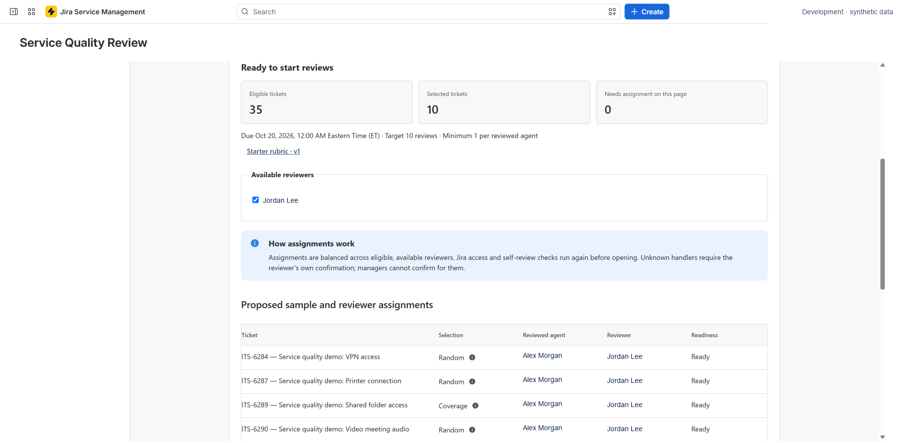

# Prepare periods and sample requests

A period groups requests from a defined population window and turns the selected sample into assigned reviews. A clear population and selection method make the resulting report easier to interpret.

## Define the period

In **Periods**, configure the period and the dates of the request population to review. Check the program's time zone, published rubric, reviewed-agent roster, and available reviewers before preparing the sample.

The population window describes the requests being considered; it is different from the deadline reviewers have to complete their work.

## Choose selection methods deliberately

| Selection kind | Purpose | How to interpret it |
| --- | --- | --- |
| Random | Choose requests reproducibly by chance from the eligible population. | Read with the population, eligibility rules, and sample size. |
| Coverage | Add requests to meet a minimum for each reviewed agent. | Understand which agents had eligible requests and whether shortfalls remain. |
| Targeted | Choose requests matching a targeted rule. | Shows the selected area of interest, not a general random estimate. |
| Manual inclusion | Explicitly include a request in the period sample. | Keeps its manual selection label in results. |

Inspect the preparation summary, exclusions, and any shortfalls. A minimum target does not guarantee that enough eligible requests exist for every agent. Do not describe a shortfall as completed coverage.

<figure markdown>

<figcaption>Inspect sample preparation and readiness before opening reviews. Example data is synthetic.</figcaption>
</figure>

## Finalize, assign, and start

Review the sample before finalizing it. Once finalized, its selection is frozen.

Check the assigned reviewers and deadlines, then choose **Start reviews** when the period is ready. Preparation, assignment, and opening can run in the background. A saved checkpoint or a finalized sample alone does not mean reviews are open.

Use the displayed progress and recovery actions if work is interrupted. The app checks current eligibility and prevents reviewers from reviewing their own work.

## Recurrence and reminders

Opt into weekly or monthly recurrence and reminders when you are ready. Scheduled work is checked approximately hourly; it does not promise an exact delivery time. Missed occurrences are created one at a time, oldest first.

Assignments and reminders appear in **Updates** and app banners. There is no email, Slack, or mobile notification delivery.

## Finish the period

Monitor progress, address blocked assignments using the available actions, and close the period when appropriate. Results can be read while a period is open, but remain provisional as reviews arrive or change. Closing a period also matters for the [retention clock](../administration/data.md).
