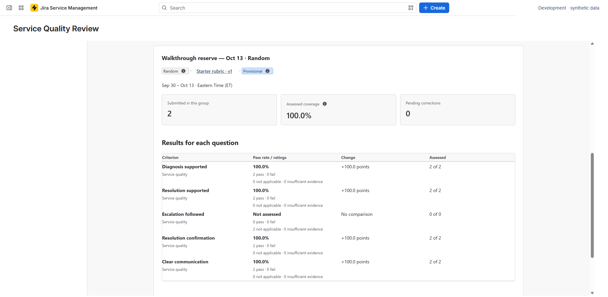

# Read results and export outcomes

Open **Results** to understand submitted judgments and assessed coverage. Read the population, selection method, rubric version, and completion state before comparing scores.

## Read score and coverage together

**Assessed coverage** is the share of applicable criterion weight reviewers could judge from the evidence. N/A answers are excluded from the applicable amount. Insufficient-evidence answers reduce coverage rather than becoming passes or failures.

For example, two reviews can show similar scores while one has much less assessable evidence. The lower-coverage result supports a narrower conclusion. This example illustrates interpretation; it is not a published benchmark.

Open periods can show **provisional** results. Their totals may change as reviews are submitted or corrected. A period with no completed assessments does not establish either good or poor quality.

<figure markdown>

<figcaption>Compare the assessment outcome with coverage and sample context. Example data is synthetic.</figcaption>
</figure>

## Compare like with like

- Keep rubric versions visible. A revised standard can change scores without a change in service.
- Separate random, targeted, coverage, and manually included selections.
- Check sample shortfalls, exclusions, and incomplete work.
- Use later-period comparisons with the same context in view.
- Keep calibration and standalone ticket reviews separate from ordinary period totals.

A targeted sample highlights an area of interest; it should not be presented as a random estimate for the whole service.

## Export completed results

Use the completed-results CSV action in **Results**. The export contains authorized completed outcomes, criterion/rubric and selection labels, and coverage. It excludes private notes, quotations, and AI text.

Current Jira **issue visibility** governs the numeric rows. This is different from the source checks for content-bearing records, which also consider cited comments. Inaccessible issue rows are excluded. If the app cannot establish a complete and consistent authorized export, it withholds the file rather than returning a misleading partial result.

Downloaded files cannot be recalled after permissions change. Store and share them under your organization's policies, and export needed outcomes before uninstalling or deleting app data.

## Decide what to do next

Use [Findings and coaching](findings-coaching.md) to connect a result to a practical action. Avoid drawing a broad conclusion from one score, a low-coverage assessment, or a deliberately targeted sample.
