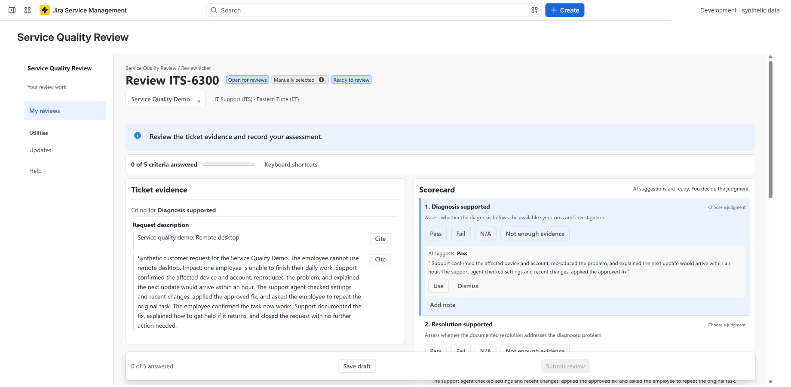

# Service Quality Review

Turn service requests into evidence-based reviews, consistent standards, and useful coaching.

Service Quality Review for Jira Service Management helps teams run recurring human reviews of service requests. Choose the tickets, assess them against published criteria, compare judgments, and follow through on what you learn. Optional AI helps reviewers find evidence; people make and submit every assessment.

## Start with one request

Set up a program, publish its review criteria, and invite a reviewer to assess one ticket. This is the shortest way to learn the workflow before preparing a recurring sample.

**[Follow the first-review guide →](getting-started/first-review.md)**

Already assigned a review? Go straight to **[Complete a review](guides/reviews.md)**.

## Find your task

| I want to… | Read this |
| --- | --- |
| Install the app and arrange access | [Installation](getting-started/installation.md) and [roles](getting-started/roles.md) |
| Define what good service looks like | [Programs](guides/programs.md) and [review criteria](guides/criteria.md) |
| Select requests and assign a review period | [Periods and sampling](guides/periods.md) |
| Assess a ticket with supporting evidence | [Complete a review](guides/reviews.md) and [AI assistance](guides/ai.md) |
| Bring reviewers into agreement | [Calibration](guides/calibration.md) |
| Understand results and export outcomes | [Results and exports](guides/results.md) |
| Turn reviews into practical improvements | [Findings and coaching](guides/findings-coaching.md) |
| Manage access, retention, or deletion | [Administration](administration/access.md) |

## How the workflow fits together

A **program** holds a team's criteria and people. A **period** selects requests from a date range. Assigned **reviewers** assess those requests. **Results** show submitted judgments and how much could be assessed. **Findings** and **coaching** help managers act on the outcome.

<figure markdown>

<figcaption>The reviewer reads ticket evidence alongside the scorecard. This example uses synthetic data.</figcaption>
</figure>

Reviews are private by default and follow current Jira permissions. A high score needs to be read alongside assessed coverage and the way tickets were selected. A lack of evidence is neither a pass nor a fail.

Need help? [Check troubleshooting](help/troubleshooting.md) or [contact Magnascale support](help/support.md).
